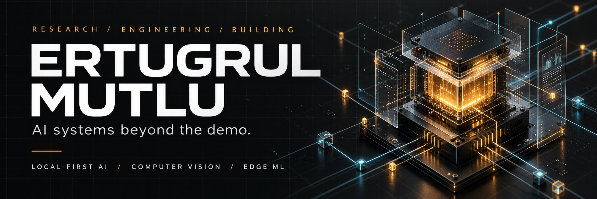
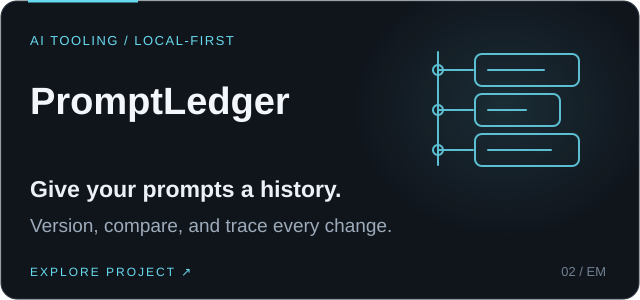
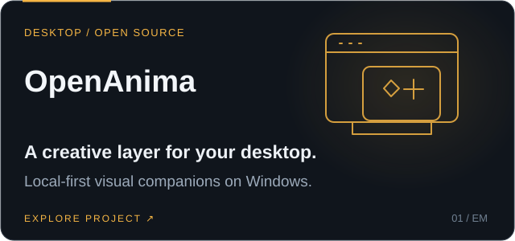

<strong>Computer Engineering B.Sc. student at RWTH Aachen University</strong>

I build tools for evaluating LLM workflows and simulators for inspecting how software and hardware behave. At Fraunhofer IAIS, my research has focused on agentic AI and LLM tooling.

  
  
  

## From Lab to Code

Six interactive engineering projects in Python and C++, covering image processing, spatial audio, robot kinematics, neural network efficiency, real-time control, and hardware simulation.

<table>
<tr>
<td width="45%" valign="top">
  
</td>
<td width="55%" valign="top">
  <strong>SystemC Architecture Playground</strong>
  
Edit and compile C++/SystemC models, step through simulation events, and inspect VCD waveforms. The four experiments span digital adders and a CPU–memory platform with configurable TLM latency.

  
<a href="https://github.com/Ertugrulmutlu/from-lab-to-code/tree/main/06-systemc-architecture-playground">Source</a> · <a href="https://dev.to/ertugrulmutlu/from-lab-to-code-6-exploring-hardware-simulation-with-c-and-systemc-5b1h">Technical write-up</a>

</td>
</tr>
</table>

[Browse all six projects](https://ertugrulmutlu.github.io/from-lab-to-code/) · [Series repository](https://github.com/Ertugrulmutlu/from-lab-to-code)

## Open-source projects

<table>
<tr>
<td width="50%" valign="top">
  
  
<strong>PromptLedger</strong> tracks prompt versions in SQLite. Compare changes, record evaluation results, and check benchmark results against regression policies through the CLI or Python API.

  
<a href="https://github.com/Ertugrulmutlu/promptledger">Source</a> · <a href="https://pypi.org/project/promptledger/">PyPI</a>

</td>
<td width="50%" valign="top">
  
  
<strong>OpenAnima</strong> runs animated overlays on the Windows desktop. It supports sprites, GIFs, APNG, and WebM, with multi-monitor placement and saved sessions.

  
<a href="https://github.com/Ertugrulmutlu/OpenAnima">Source</a> · <a href="https://ertugrulmutlu.github.io/OpenAnima/">Website</a> · <a href="https://apps.microsoft.com/detail/9n3hp2wxkxlg">Microsoft Store</a>

</td>
</tr>
</table>

| Project | What it does |
| --- | --- |
| [Edge AI Sound Classifier](https://github.com/Ertugrulmutlu/Edge-AI-Sound-Classifier-on-Raspberry-Pi-Pico) | Extracts audio features in Python and runs four-class inference on an RP2040 with C++ firmware. |
| [JumpNet](https://github.com/Ertugrulmutlu/JumpNet) | Records frames and keypresses, trains a behavior-cloning model, and predicts jump timing and duration in real time. |
| [DataLens](https://github.com/Ertugrulmutlu/DataLens) | Audits image datasets for corrupt files, exact and near duplicates, and label coverage before training. |

## Research and talks

**Behavioral Convergence Without Representational Convergence**  
In controlled MNIST experiments, I studied how reversing the order of training tasks can leave measurable differences in CNN representations even when models reach similar predictive performance. [arXiv preprint](https://arxiv.org/abs/2609.37836) · [Reproduction code](https://github.com/Ertugrulmutlu/hysteresis-neural-networks)

- **Python Summit 2026** · *From Prompt Mess to Prompt Observability* — lessons from building PromptLedger to track and debug prompt changes. [Build series](https://dev.to/ertugrulmutlu/series/35047)
- **DataTalks.Club** · *From Human-in-the-Loop to Agent-in-the-Loop* — feedback, evaluation, and human judgment in agentic workflows. [Talk recording](https://www.youtube.com/watch?v=HwCR59VuYn4)
